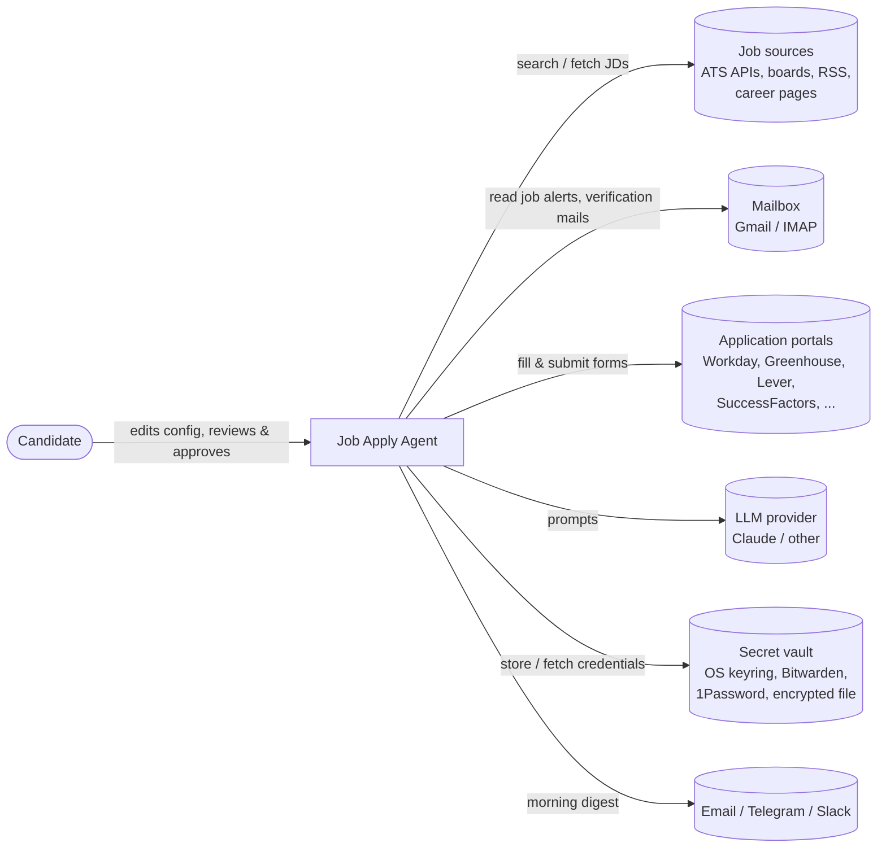
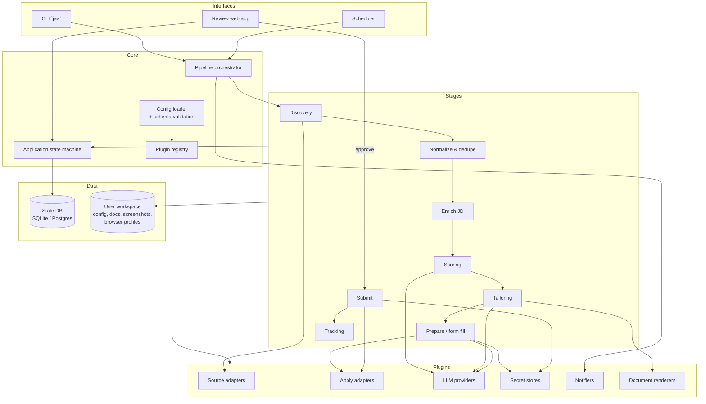

# 01 — Architecture

**Status:** Draft for review · **Last updated:** 2026-11-07

This document explains *what* the Job Apply Agent is, the principles it is built on,
and the big building blocks. The [HLD](02-hld.md) describes how those blocks
work together; the [LLD](03-lld.md) describes classes, schemas and config files.

---

## 1. Problem and intent

A job seeker targeting several role families (e.g. *Solution/Enterprise Architect*,
*SAP Commerce (Hybris) Architect/Lead*, *Engineering Manager*) needs to apply to many
relevant jobs every day. Doing this by hand is slow: searching many portals,
reading JDs, tailoring the resume, answering the same screening questions again and again.

**Intent:** an agent that, every night, **finds** relevant jobs, **ranks** them against
the candidate, **prepares** a tailored application (resume, cover letter, answers,
pre-filled form saved as a draft), and every morning lets the candidate **review and
approve** with one click — after which it **submits** and **tracks** the application.

## 2. Goals

| ID | Goal |
|---|---|
| G1 | **Configuration over code.** A new user changes YAML/Markdown files, never Python, to change roles, portals, scoring, prompts, templates, schedule, LLM, notifications. |
| G2 | **Discover widely.** Pull jobs from many sources (ATS APIs, job boards, RSS, job-alert emails, career pages, manual lists). |
| G3 | **Rank honestly.** Hard filters + keyword score + LLM fit score, with reasons, using thresholds the user controls. |
| G4 | **Tailor without lying.** Tailored resume/cover letter built only from facts in the master profile; every claim traceable. |
| G5 | **Prepare drafts overnight.** Fill application forms up to (not including) Submit, save drafts, screenshot them. |
| G6 | **Human approval gate.** Morning review page; nothing is submitted without approval (default, configurable). |
| G7 | **Safe accounts and secrets.** Portal accounts/passwords kept in a secret vault, never in plain text, logs or reports. |
| G8 | **Track and learn.** Track every application's status; answers the user gives to new questions are saved and reused. |
| G9 | **Multi-user ready.** Everything user-specific lives in a user workspace folder; the same install serves many users. |

## 3. Non-goals (v1)

- Bypassing CAPTCHAs, bot detection, or a portal's terms of service.
- Mass-messaging recruiters or auto-connecting on LinkedIn.
- Inventing experience, skills, titles or dates.
- Interview scheduling, salary negotiation.
- A hosted multi-tenant SaaS (v1 runs on the user's machine or a single server).

## 4. Architectural principles

1. **Plugin + declarative config.** Behaviour is chosen by a `type:` key in config that
   maps to a registered plugin. Plugins are generic enough that most new portals need
   *only* a YAML file (selectors, URL templates, field mappings). Code is needed only for
   a genuinely new *kind* of integration.
2. **Pipeline of idempotent stages.** `discover → normalize → enrich → score → tailor →
   prepare → review → submit → track`. Each stage reads and writes the state store,
   so any stage can be re-run, resumed or run on its own.
3. **Explicit state machine.** Every application has one status; transitions are
   validated. This is what makes the morning review and audit possible.
4. **Human in the loop by default.** Low-confidence answers, CAPTCHAs, sign-up walls,
   sensitive questions → `NEEDS_HUMAN`, never a guess.
5. **Respect each portal.** Every portal declares how it may be used (`api`,
   `browser_fill`, `assist_only`), plus rate limits and daily caps. Portals that forbid
   automation run in `assist_only` (the agent prepares everything, the human clicks).
6. **Provider-agnostic AI.** LLM, embeddings, browser, storage, secrets and notifications
   sit behind interfaces; the concrete provider is a config choice.
7. **Secrets by reference.** Config contains `${env:NAME}` or `${vault:path}` references,
   never values.
8. **Privacy.** Logs carry IDs only; personal data stays in the user workspace and DB.

## 5. System context

## 6. Building blocks (containers)

| Block | Responsibility |
|---|---|
| **Config loader** | Merges layered config (defaults → user workspace → env → CLI), resolves `${env:}`/`${vault:}` refs, validates with schemas, reports friendly errors. |
| **Plugin registry** | Maps `type:` strings to plugin classes; loads built-ins and third-party plugins (Python entry points). |
| **Pipeline orchestrator** | Runs stages in order or individually; concurrency, retries, budgets (LLM spend, daily caps), dry-run. |
| **State machine** | Owns application statuses and legal transitions; writes an audit event for each. |
| **Discovery** | Runs every enabled source for every search profile; emits raw jobs. |
| **Normalize & dedupe** | Maps raw jobs to the canonical `Job` model; dedupes across portals (same role re-posted). |
| **Enrich** | Fetches the full JD, detects the apply method/ATS, extracts structured requirements. |
| **Scoring** | Hard filters → keyword score → LLM fit score → weighted total → bucket (prepare / review-only / drop). |
| **Tailoring** | Picks the best résumé variant, selects and rephrases bullets, writes cover letter and screening answers; fact-checks against the master profile; renders PDF/DOCX. |
| **Prepare** | Uses the apply adapter to log in (saved session), fill the form, upload documents, stop before Submit, save draft + screenshots. |
| **Review web app** | Morning queue sorted by score; view JD, tailored docs, filled answers, screenshots; edit, approve, skip, bulk-approve; answer `NEEDS_HUMAN` questions. |
| **Submit** | Submits approved applications (or hands the user a one-click "assist pack" for `assist_only` portals). |
| **Tracking** | Reads confirmation/rejection/interview emails, updates statuses, schedules follow-ups. |

## 7. Technology choices (proposed)

| Concern | Choice | Why | Swappable via |
|---|---|---|---|
| Language | Python 3.12 | Best ecosystem for scraping, browser automation, LLM SDKs | — |
| Config | YAML + Jinja2 (prompts/templates) + Pydantic v2 schemas | Human-editable, validated, self-documenting | — |
| Browser automation | Playwright (persistent contexts) | Reliable, handles modern SPAs (Workday), screenshots, PDF | `browser.engine` |
| LLM | Anthropic Claude via official SDK (default) | Strong structured output and reasoning | `llm.provider` |
| State store | SQLite via SQLAlchemy 2 (Postgres optional) | Zero setup locally; same models on a server | `storage.url` |
| Review UI | FastAPI + HTMX + Jinja templates | No JS build step; easy to restyle | `review.*` |
| Scheduling | Built-in APScheduler, or OS cron / GitHub Actions calling the CLI | Works on laptop and server | `schedule.*` |
| Secrets | `keyring` (default), Bitwarden CLI, 1Password CLI, age-encrypted file | Passwords never in plain text | `secrets.backend` |
| Documents | Jinja → HTML → PDF (Playwright print); DOCX via `python-docx` | Template-driven, ATS-friendly | `documents.*` |
| Notifications | Email (SMTP/Gmail), Telegram, Slack webhook, console | Morning digest where the user is | `notify.channels` |
| Packaging | `uv` + Docker image | One-command setup | — |

## 8. Deployment options

| Mode | Where | Good for | Limitation |
|---|---|---|---|
| **Local (recommended)** | User's laptop, scheduled overnight | Logged-in portals, residential IP, headful login when needed | Laptop must be on |
| **Server / Docker** | Small VM or home server | Always on | Some portals block datacentre IPs; first login via remote browser (noVNC) |
| **Hybrid** | Discovery + scoring + tailoring in cloud (e.g. GitHub Actions); prepare/submit locally | Cheap, robust | Two places to configure |

## 9. Key risks and mitigations

| Risk | Mitigation |
|---|---|
| Portal bans the account for automation | Per-portal `mode`, human-paced delays, daily caps, `assist_only` for portals that forbid bots |
| CAPTCHA / email verification on sign-up | Never bypassed: status `NEEDS_HUMAN`; email codes read from mailbox only if the user enables it |
| LLM invents experience | Fact-check stage: every tailored bullet must map to a master-profile fact ID, otherwise rejected |
| Wrong answer to a screening question | Confidence threshold; sensitive-question policy; all answers visible in review before submit |
| Leaking passwords / PII | Vault references only; reports show username + "reveal" action; logs carry IDs only |
| Portal UI changes break form fill | Selectors in config (no redeploy), LLM-assisted generic form filler as fallback, screenshot on failure |
| LLM cost runaway | Per-run and per-day budget in config; cheap model for scoring, stronger model for tailoring |
