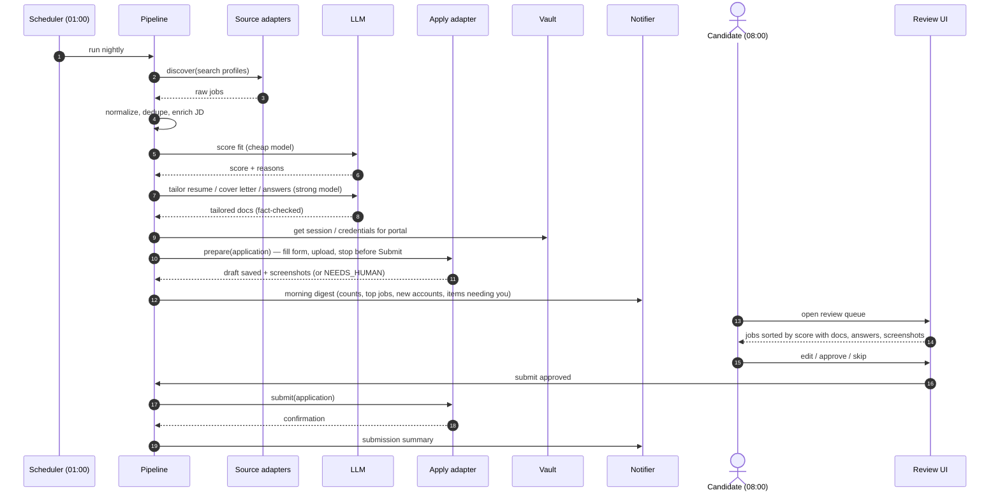
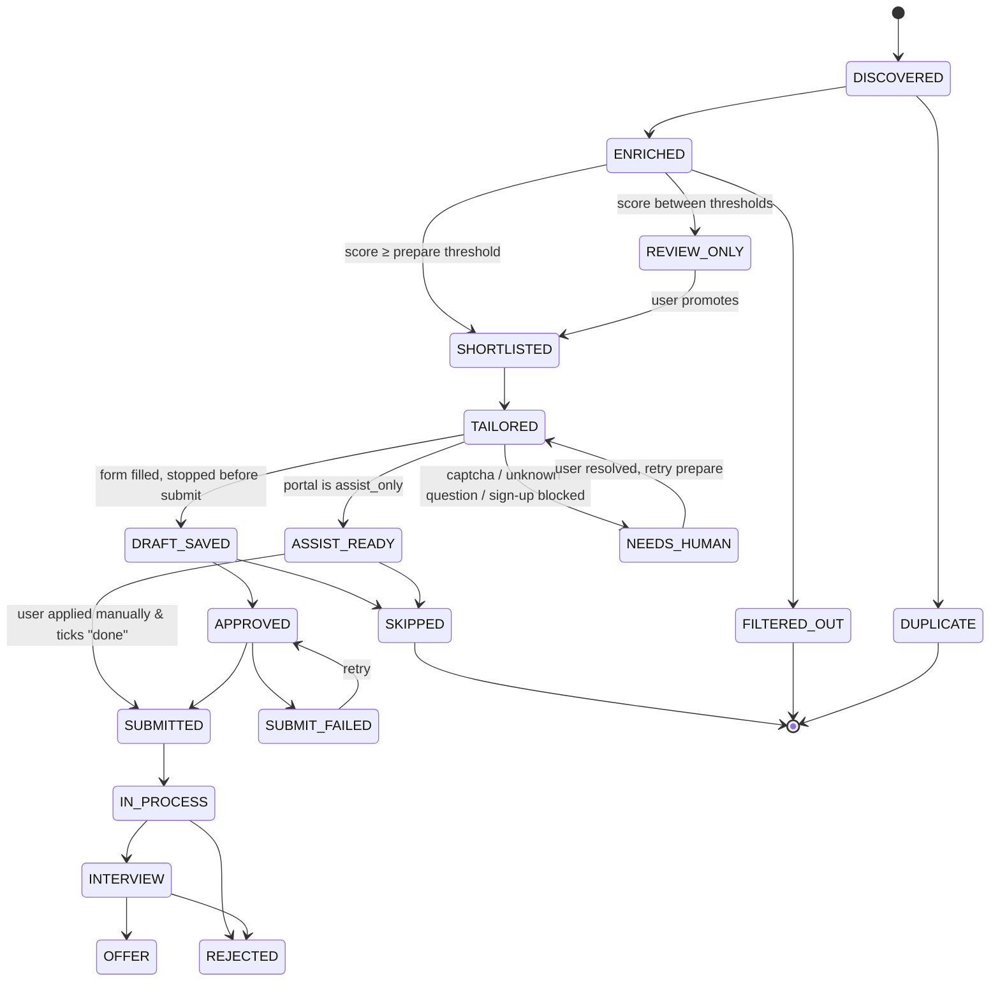

# 02 — High-Level Design (HLD)

**Status:** Draft for review · **Last updated:** 2026-11-07
Read [01-architecture.md](01-architecture.md) first.

---

## 1. Daily flow



## 2. Pipeline stages

Each stage is idempotent, picks up only the applications in its input status, and can be
run alone (`jaa run <stage>`). Stages are listed in `config/app.yaml → pipeline.stages`,
so a user can drop or reorder optional ones (e.g. skip `cover_letter`).

| # | Stage | Input → Output status | What it does | Config files |
|---|---|---|---|---|
| 1 | `discover` | — → `DISCOVERED` | For each enabled **search profile** × enabled **source**, query and collect raw postings. | `search.yaml`, `portals/*.yaml` |
| 2 | `normalize` | raw → `Job` | Map fields to canonical model; parse salary, location, seniority, remote type; compute dedupe key. | `normalize.yaml` (synonyms, title/location maps) |
| 3 | `enrich` | `DISCOVERED` → `ENRICHED` | Fetch full JD; detect ATS from apply URL (`*.myworkdayjobs.com` → workday); extract requirements via LLM. | `portals/*.yaml` (url patterns) |
| 4 | `score` | `ENRICHED` → `SHORTLISTED` / `REVIEW_ONLY` / `FILTERED_OUT` | Hard filters, keyword score, LLM fit score, weighted total, bucketing. | `scoring.yaml`, `prompts/score.md.j2` |
| 5 | `tailor` | `SHORTLISTED` → `TAILORED` | Choose résumé variant per role family; tailor summary/bullets; cover letter; answers; fact-check; render. | `profile.yaml`, `resume.yaml`, `answers.yaml`, `prompts/*`, `templates/*` |
| 6 | `prepare` | `TAILORED` → `DRAFT_SAVED` / `ASSIST_READY` / `NEEDS_HUMAN` | Run apply adapter in prepare mode; stop before final submit. | `portals/*.yaml`, `secrets` |
| 7 | `review` | `DRAFT_SAVED`/`ASSIST_READY` → `APPROVED` / `SKIPPED` | Human decision in UI (or CLI). | `review.yaml` |
| 8 | `submit` | `APPROVED` → `SUBMITTED` / `SUBMIT_FAILED` | Final submit; capture confirmation. | `portals/*.yaml` |
| 9 | `track` | `SUBMITTED` → `IN_PROCESS` / `INTERVIEW` / `REJECTED` / `OFFER` | Parse mailbox for status emails; follow-up reminders. | `tracking.yaml` |

## 3. Application lifecycle (state machine)



Every transition writes an `ApplicationEvent` (who/what, from, to, reason, timestamp).

## 4. Configuration model

### 4.1 Layers (later overrides earlier)

1. **Built-in defaults** shipped in `src/jaa/defaults/` (sensible values for everything).
2. **Workspace config** — `workspaces/<user>/config/*.yaml` (what a user edits).
3. **Environment variables** — `JAA__<SECTION>__<KEY>` (e.g. `JAA__LLM__MODEL=...`).
4. **CLI flags** — e.g. `--dry-run`, `--only-portal greenhouse`, `--max-applications 20`.

`jaa config validate` checks all of it against schemas and prints the line and field
of any mistake. `jaa config show --resolved` prints the effective config (secrets masked).

### 4.2 Workspace layout (one per user)

```
workspaces/<user>/
  config/
    app.yaml            # runtime: schedule, pipeline stages, LLM, storage, budgets, notifications
    profile.yaml        # facts about the candidate (contact, work auth, notice period, salary...)
    resume.yaml         # master résumé as structured facts with IDs (source of truth for tailoring)
    answers.yaml        # screening-question bank (grows as the user answers new questions)
    search.yaml         # role families → titles, keywords, locations, exclusions
    scoring.yaml        # filters, weights, thresholds, "aggressiveness"
    normalize.yaml      # optional: title/location synonyms
    tracking.yaml       # optional: email patterns for status updates
    review.yaml         # optional: UI options, bulk-approve rules
    portals/            # one file per portal/source; enable/disable by flag
      greenhouse.yaml
      lever.yaml
      workday.yaml
      linkedin.yaml
      naukri.yaml
      company-career-pages.yaml
      ...
  prompts/              # optional overrides of built-in prompt templates (*.md.j2)
  templates/            # optional résumé / cover-letter templates (*.html.j2, *.docx)
  data/                 # generated: db, documents, screenshots, browser profiles (git-ignored)
```

A new user runs `jaa init <name>` → workspace created from `examples/`, then edits YAML.

### 4.3 What a user can change without code

| Want to… | Edit |
|---|---|
| Target a new role family (e.g. "Delivery Head") | `search.yaml` → add a profile |
| Apply more aggressively | `scoring.yaml` → `aggressiveness: high` (lowers thresholds, raises caps) |
| Add a company's Greenhouse/Lever/Workday board | `portals/greenhouse.yaml` → add the board token / tenant |
| Add a brand-new job board with a list page | new `portals/<name>.yaml` with `type: html_list` and CSS selectors |
| Add a JSON job API | new `portals/<name>.yaml` with `type: json_api` and field mappings |
| Use job-alert emails (LinkedIn/Naukri alerts) | `portals/email-alerts.yaml` with sender + link patterns |
| Change how the cover letter sounds | `prompts/cover_letter.md.j2` |
| Change résumé look | `templates/resume.html.j2` |
| Use a different LLM / model | `app.yaml → llm` |
| Store passwords in Bitwarden instead of keyring | `app.yaml → secrets.backend` |
| Get digest on Telegram | `app.yaml → notify.channels` |
| Turn off approval for a trusted portal | `portals/<name>.yaml → require_approval: false` (default true) |

## 5. Discovery

**Source types** (plugins; chosen by `type:` in a portal file):

| `type` | Covers | Config needed |
|---|---|---|
| `greenhouse` | Any company on Greenhouse (public board API) | list of board tokens |
| `lever` | Any company on Lever (public postings API) | list of company slugs |
| `ashby`, `smartrecruiters`, `recruitee` | Same idea | company identifiers |
| `workday` | Workday tenants (public CXS search endpoint) | tenant + site list |
| `json_api` | Any JSON job API / aggregator | URL template, auth ref, JSONPath field map, pagination |
| `html_list` | Any job list page | URL template, CSS selectors, pagination, rate limit |
| `rss` | RSS/Atom feeds | feed URLs |
| `email_alerts` | LinkedIn/Naukri/Indeed alert emails | mailbox ref, sender filters, link regex |
| `manual` | CSV/YAML of job URLs the user pastes | file path |

Every source receives each **search profile** (role family) and expands URL templates
with its keywords/locations, so one portal file serves all role families.

**Dedupe key:** `normalize(company) + normalize(title) + normalize(location)` plus
JD-text similarity (embedding or shingle hash) ≥ configured threshold → `DUPLICATE`,
linking to the canonical job. Also skips jobs already applied to within
`dedupe.reapply_after_days`.

## 6. Scoring

```
total = Σ weight_i × signal_i        (signals normalised 0–100)
signals: llm_fit, keyword_match, title_match, seniority_match, location_match,
         recency, company_preference, salary_match
bucket:  total ≥ thresholds.prepare      → SHORTLISTED
         total ≥ thresholds.review_only  → REVIEW_ONLY
         else                            → FILTERED_OUT
```

- **Hard filters** run first (cheap, no LLM): excluded title words, excluded companies,
  location/remote rules, posted-within-days, required work authorization, already applied.
- **LLM fit** uses a cheap model with a structured output: `score`, `matched_requirements`,
  `gaps`, `role_family`, `seniority`, `red_flags`, `one_line_pitch`.
- **Aggressiveness** preset (`low|medium|high|custom`) sets thresholds and caps together.
- Daily caps per portal and overall stop the queue from flooding.

## 7. Tailoring (G4: no invented facts)

1. **Variant selection:** `resume.yaml` holds facts; `search.yaml` maps each role family
   to a résumé *variant* (which sections/bullets lead, which headline).
2. **Bullet selection & rephrasing:** LLM receives the JD + fact list (each fact has an
   ID) and returns `[{fact_id, text}]`. It may reword, not add.
3. **Fact-check:** a second, independent pass verifies every output sentence is supported
   by its `fact_id`; numbers, dates, employers, titles and skills must match exactly.
   Failures are dropped or the doc is flagged.
4. **Cover letter & answers:** same rule — built from `profile.yaml`, `resume.yaml`,
   `answers.yaml` and the JD.
5. **Render:** Jinja template → HTML → PDF (and DOCX if the portal prefers).
   Output stored in `data/docs/<application_id>/`.

## 8. Prepare and submit (apply adapters)

| `apply.mode` (per portal) | Prepare does | Submit does |
|---|---|---|
| `api` | Builds the payload (where an official apply API exists) | POSTs it |
| `browser_fill` | Opens saved browser session, fills form, uploads docs, stops before final submit, screenshots each step, saves portal draft if supported | Re-opens, verifies fields unchanged, clicks submit, captures confirmation |
| `assist_only` | Builds an **assist pack**: apply link, tailored PDF, cover letter, every answer ready to copy | Nothing; user applies and ticks "done" in the UI |
| `email` | Drafts the email with attachments (mail draft folder) | Sends the draft |

**Form filling engine (for `browser_fill`):**

1. Portal file may declare **explicit field mappings** (selector → profile path) — fastest and most reliable.
2. Otherwise the **generic filler** extracts all fields (label, type, options, required),
   matches each one to the answers bank (exact → fuzzy → semantic), then asks the LLM
   with profile context for the rest, with a confidence score.
3. Below `confidence_threshold`, or a question in `sensitive_questions` (EEO, disability,
   criminal record, visa if not set in profile) → left empty, `NEEDS_HUMAN`.
4. Answers the user gives in review are written back to `answers.yaml` (if
   `answers.learn: true`), so the next form fills itself.

**Accounts:** portal policy `account_creation: never | assist | auto`.
- `assist` (default): agent opens the sign-up page pre-filled, user completes it once.
- `auto`: agent generates a strong password, stores it in the vault **before**
  submitting the sign-up form, uses the configured email alias, and reads the
  verification mail if mailbox access is enabled. CAPTCHA → `NEEDS_HUMAN`.
- The morning digest lists new accounts: portal, username, vault entry name. The review
  UI has a **Reveal password** button that reads from the vault on demand — passwords
  are never written to the DB, reports or emails.

**Sessions:** each portal gets a persistent browser profile in `data/browser/<portal>/`.
`jaa portal login <portal>` opens a visible browser once for the user to sign in
(handles 2FA); later runs reuse the session.

## 9. Review experience

- **Queue** (default view): cards sorted by score — title, company, location, score with
  reasons, portal, status badge, "new account created" badge.
- **Detail:** JD (with matched/missing requirements highlighted), tailored résumé diff
  vs master, cover letter (editable), all answers (editable), screenshots of the filled form.
- **Actions:** Approve · Skip (with reason, feeds scoring tuning) · Edit & approve ·
  Promote (REVIEW_ONLY → SHORTLISTED) · Bulk approve (e.g. "all ≥ 85 from Greenhouse").
- **Needs you:** questions the agent could not answer, CAPTCHAs, logins expired.
- Same actions exist on the CLI (`jaa review list|approve|skip`) for headless use.

## 10. Cross-cutting concerns

| Concern | Design |
|---|---|
| **Rate limiting** | Token bucket per portal from config (`requests_per_minute`, `jitter_seconds`), daily `max_applications`. |
| **Retries** | Exponential backoff for network; no retry on validation/captcha errors. |
| **Budgets** | `budgets.llm_usd_per_day`, `budgets.max_jobs_per_run`; pipeline stops gracefully when reached. |
| **Observability** | Structured JSON logs (IDs only), run summary table, per-stage metrics in DB, failure screenshots. |
| **Dry run** | `--dry-run`: everything except submit and account creation. |
| **Security** | Secrets via vault refs; workspace `data/` git-ignored; review UI binds to localhost with a token. |
| **Testing** | Unit tests per plugin with recorded fixtures; local fake portal (static HTML forms) for E2E; prompt evals on a fixed set of JDs. |
| **Extensibility** | New plugin = class + `@register("type")`; external packages via entry points `jaa.sources`, `jaa.apply`, `jaa.llm`, `jaa.secrets`, `jaa.notify`. |

## 11. Phased delivery

| Phase | Scope | Outcome for the user |
|---|---|---|
| **P1** | Config system, workspace init, discovery (greenhouse, lever, workday, json_api, html_list, rss, manual), normalize/dedupe, scoring, CLI, SQLite | Daily ranked list of relevant jobs |
| **P2** | Tailoring (résumé, cover letter, answers) with fact-check, PDF render, review UI, `assist_only` packs, digest | Morning queue with ready-to-use documents and answers |
| **P3** | Browser prepare/submit for Greenhouse & Lever, generic form filler, vault, sessions, `NEEDS_HUMAN` flow | Drafts saved overnight, one-click submit |
| **P4** | Workday / SuccessFactors adapters, account creation (`assist`/`auto`), email-alert source, tracking | Broad coverage + status tracking |
| **P5** | Learning loop (answers, skip reasons → scoring), Docker/server mode, multi-user polish | Lower effort over time |
