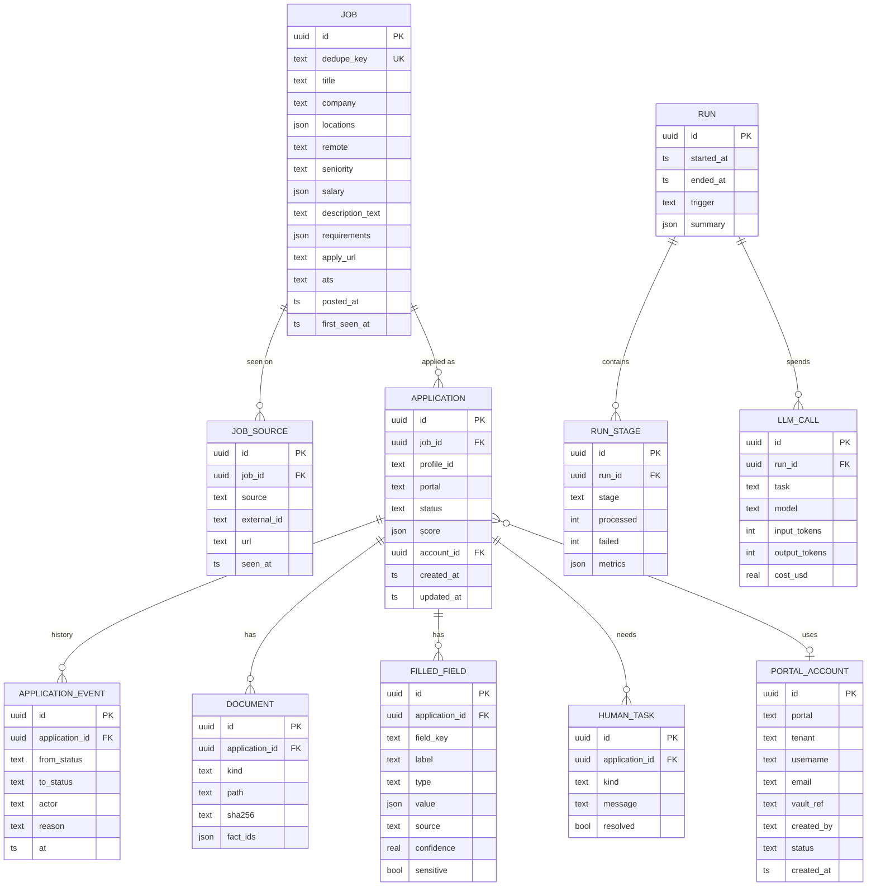

# 03 — Low-Level Design (LLD)

**Status:** Draft for review · **Last updated:** 2026-11-07
Read [01-architecture.md](01-architecture.md) and [02-hld.md](02-hld.md) first.
Code samples are **interface sketches**, not final code.

---

## 1. Repository layout

```
job-apply-agent/
├─ pyproject.toml                # uv / pip; console script `jaa`
├─ src/jaa/
│  ├─ cli.py                     # Typer app: init, config, run, review, portal, status
│  ├─ core/
│  │  ├─ config/                 # loader.py, schemas/*.py (Pydantic), resolvers.py (${env:}, ${vault:})
│  │  ├─ registry.py             # plugin registry + entry-point loading
│  │  ├─ models.py               # domain models (Job, Application, ...) — Pydantic
│  │  ├─ states.py               # Status enum + transition table
│  │  ├─ pipeline.py             # orchestrator, Stage base class, RunContext
│  │  ├─ budget.py, ratelimit.py, errors.py, logging.py
│  ├─ stages/                    # discover.py, normalize.py, enrich.py, score.py, tailor.py,
│  │                             # prepare.py, submit.py, track.py
│  ├─ plugins/
│  │  ├─ sources/                # greenhouse.py, lever.py, ashby.py, workday.py, json_api.py,
│  │  │                          # html_list.py, rss.py, email_alerts.py, manual.py
│  │  ├─ apply/                  # greenhouse.py, lever.py, workday.py, generic_form.py,
│  │  │                          # assist_only.py, email_apply.py
│  │  ├─ llm/                    # anthropic.py, openai_compat.py, fake.py (tests)
│  │  ├─ secrets/                # keyring_store.py, bitwarden.py, onepassword.py, age_file.py, env.py
│  │  ├─ notify/                 # email.py, telegram.py, slack.py, console.py
│  │  ├─ mail/                   # gmail_api.py, imap.py  (read alerts / verification / status mails)
│  │  └─ render/                 # html_pdf.py, docx.py
│  ├─ forms/                     # field extraction, answer matching, filler engine
│  ├─ tailoring/                 # variant selection, bullet rewrite, fact-checker
│  ├─ storage/                   # SQLAlchemy models, repositories, migrations (Alembic)
│  ├─ review/                    # FastAPI app, HTMX templates, static
│  └─ defaults/                  # built-in default config, prompts, templates
├─ examples/dummy-user/          # complete sample workspace (dummy résumé, fake portals)
├─ workspaces/                   # real user workspaces (git-ignored except .gitkeep)
├─ tests/
│  ├─ unit/  ├─ integration/  ├─ e2e/ (fake portal site)  └─ evals/ (prompt evals)
└─ docs/
```

## 2. Domain models (`core/models.py`)

```python
class SearchProfile(BaseModel):          # from search.yaml
    id: str                              # "sap_commerce"
    titles: list[str]                    # include titles
    keywords_any: list[str]; keywords_all: list[str] = []
    exclude_keywords: list[str] = []
    seniority: list[Seniority]           # lead, architect, manager, director...
    locations: list[LocationRule]
    resume_variant: str                  # key into resume.yaml variants
    priority: int = 1

class RawJob(BaseModel):                 # what a source adapter returns
    source: str; external_id: str; url: HttpUrl
    title: str; company: str | None; location: str | None
    posted_at: datetime | None; description_html: str | None
    apply_url: HttpUrl | None; extra: dict[str, Any] = {}

class Job(BaseModel):                    # canonical, after normalize
    id: UUID; dedupe_key: str
    title: str; title_normalized: str; company: str
    locations: list[Location]; remote: Literal["onsite","hybrid","remote","unknown"]
    seniority: Seniority | None; salary: SalaryRange | None
    description_text: str; requirements: list[Requirement] = []
    apply_url: HttpUrl; ats: str | None  # detected: workday, greenhouse, ...
    sources: list[SourceRef]             # every portal it was seen on
    posted_at: datetime | None; first_seen_at: datetime

class ScoreResult(BaseModel):
    total: float; bucket: Literal["prepare","review_only","drop"]
    signals: dict[str, float]; reasons: list[str]
    matched: list[str]; gaps: list[str]; red_flags: list[str]
    role_family: str; pitch: str

class Application(BaseModel):
    id: UUID; job_id: UUID; profile_id: str; portal: str
    status: Status; score: ScoreResult | None
    documents: list[DocumentRef] = []    # resume.pdf, cover_letter.pdf ...
    answers: list[FilledField] = []
    screenshots: list[Path] = []
    needs_human: list[HumanTask] = []
    account_id: UUID | None = None
    created_at: datetime; updated_at: datetime

class FilledField(BaseModel):
    field_key: str; label: str; type: FieldType; required: bool
    value: str | list[str] | None
    source: Literal["mapping","answers_bank","profile","llm","human"]
    confidence: float; sensitive: bool = False

class PortalAccount(BaseModel):
    id: UUID; portal: str; tenant: str | None   # e.g. workday tenant "acme"
    username: str; email: str
    vault_ref: str                       # e.g. "jaa/workday/acme" — never the password
    created_by: Literal["agent","user"]; created_at: datetime
    status: Literal["active","pending_verification","locked"]

class HumanTask(BaseModel):
    kind: Literal["question","captcha","login","signup","verification","other"]
    message: str; field_key: str | None; resolved: bool = False
```

## 3. Status and transitions (`core/states.py`)

```python
class Status(StrEnum):
    DISCOVERED, DUPLICATE, ENRICHED, FILTERED_OUT, REVIEW_ONLY, SHORTLISTED, TAILORED, \
    DRAFT_SAVED, ASSIST_READY, NEEDS_HUMAN, APPROVED, SKIPPED, SUBMITTED, SUBMIT_FAILED, \
    IN_PROCESS, INTERVIEW, REJECTED, OFFER = ...

TRANSITIONS: dict[Status, set[Status]] = {
    Status.DISCOVERED: {Status.ENRICHED, Status.DUPLICATE},
    Status.ENRICHED:   {Status.FILTERED_OUT, Status.REVIEW_ONLY, Status.SHORTLISTED},
    ...  # exactly the diagram in HLD §3
}

def transition(app, to: Status, actor: str, reason: str, repo) -> Application:
    if to not in TRANSITIONS[app.status]:
        raise IllegalTransition(app.status, to)
    repo.add_event(app.id, app.status, to, actor, reason)
    ...
```

## 4. Plugin system (`core/registry.py`)

```python
Kind = Literal["source","apply","llm","secrets","notify","mail","render"]

class Registry:
    _plugins: dict[Kind, dict[str, type]] = defaultdict(dict)
    def register(self, kind: Kind, type_name: str): ...    # decorator
    def create(self, kind: Kind, cfg: BaseModel, ctx: "RunContext"): ...
    def load_entry_points(self): ...   # group names: "jaa.source", "jaa.apply", ...

registry = Registry()

@registry.register("source", "greenhouse")
class GreenhouseSource(SourceAdapter):
    Config = GreenhouseSourceConfig       # Pydantic schema validated against portals/greenhouse.yaml
```

Each plugin declares its own `Config` model, so `jaa config validate` can validate
any portal file by looking up its `type:` and the plugin's schema. Unknown `type:` →
error listing the available types.

### 4.1 Plugin interfaces

```python
class SourceAdapter(ABC):
    name: str
    @abstractmethod
    async def discover(self, profile: SearchProfile, ctx: RunContext) -> AsyncIterator[RawJob]: ...
    async def fetch_details(self, raw: RawJob, ctx: RunContext) -> RawJob: return raw

class ApplyAdapter(ABC):
    name: str
    def matches(self, job: Job) -> bool: ...            # by ats / url pattern from config
    @abstractmethod
    async def prepare(self, app: Application, pack: ApplyPack, ctx: RunContext) -> PrepareResult: ...
    @abstractmethod
    async def submit(self, app: Application, ctx: RunContext) -> SubmitResult: ...
    async def ensure_account(self, ctx: RunContext) -> PortalAccount | HumanTask: ...

class LLMProvider(ABC):
    async def complete(self, *, task: str, prompt: str, system: str | None = None,
                       schema: type[BaseModel] | None = None,
                       max_tokens: int | None = None) -> LLMResult: ...
    # `task` ("score","tailor","factcheck","form_answer","extract") → model chosen via config

class SecretStore(ABC):
    def get(self, ref: str) -> str | None: ...
    def put(self, ref: str, value: str, meta: dict | None = None) -> None: ...
    def exists(self, ref: str) -> bool: ...

class Notifier(ABC):
    async def send(self, digest: Digest) -> None: ...

class MailReader(ABC):
    async def search(self, query: MailQuery) -> list[MailMessage]: ...

class Renderer(ABC):
    def render(self, template: Path, data: dict, out: Path) -> Path: ...
```

## 5. Pipeline (`core/pipeline.py`)

```python
@dataclass
class RunContext:
    run_id: UUID; cfg: ResolvedConfig; repo: Repository
    llm: LLMProvider; secrets: SecretStore; browser: BrowserPool
    budget: Budget; limiter: RateLimiter; dry_run: bool; log: Logger

class Stage(ABC):
    name: ClassVar[str]
    input_statuses: ClassVar[set[Status]]
    async def run(self, ctx: RunContext) -> StageReport:
        apps = ctx.repo.applications_in(self.input_statuses, limit=ctx.cfg.limits_for(self.name))
        async with TaskGroup(max_concurrency=ctx.cfg.pipeline.concurrency[self.name]) as tg:
            for app in apps: tg.spawn(self._safe(app, ctx))
    async def _safe(self, app, ctx):
        try: await self.process(app, ctx)
        except BudgetExceeded: raise StopPipeline
        except HumanNeeded as h: transition(app, Status.NEEDS_HUMAN, self.name, str(h), ctx.repo)
        except RetryableError: ...  # backoff, else record failure
    @abstractmethod
    async def process(self, app: Application, ctx: RunContext) -> None: ...

class Pipeline:
    def __init__(self, stages: list[str]): ...    # from app.yaml → pipeline.stages
    async def run(self, only: list[str] | None = None) -> RunSummary: ...
```

`discover` is the one stage with no input status; it iterates `profiles × sources`.

## 6. Configuration files (schemas + examples)

All example values below are dummies.

### 6.1 `app.yaml`

```yaml
workspace_name: dummy-user
timezone: Asia/Kolkata

schedule:
  nightly: "0 1 * * *"        # discover → prepare
  submit_approved: "*/15 7-22 * * *"
  track: "0 */4 * * *"

pipeline:
  stages: [discover, normalize, enrich, score, tailor, prepare]
  concurrency: { discover: 4, enrich: 4, score: 8, tailor: 3, prepare: 1 }
  max_jobs_per_run: 300

llm:
  provider: anthropic
  api_key: ${env:ANTHROPIC_API_KEY}
  models:                      # per task; any task falls back to `default`
    default: claude-sonnet-5-5
    score: claude-haiku-5-5
    extract: claude-haiku-5-5
    tailor: claude-opus-5-5
    factcheck: claude-sonnet-5-5
  temperature: { default: 0.2, cover_letter: 0.6 }

budgets:
  llm_usd_per_day: 5.00
  llm_usd_per_run: 3.00

storage:
  url: sqlite:///${workspace}/data/jaa.db

browser:
  engine: playwright
  headless: true
  profiles_dir: ${workspace}/data/browser
  human_delay_ms: [400, 1500]
  screenshot_each_step: true

secrets:
  backend: keyring             # keyring | bitwarden | onepassword | age_file | env
  namespace: jaa

mail:
  reader: gmail_api            # gmail_api | imap | none
  credentials: ${vault:jaa/mail/gmail}

notify:
  channels:
    - type: email
      to: ${env:JAA_DIGEST_EMAIL}
    - type: console

review:
  host: 127.0.0.1
  port: 8787
  token: ${vault:jaa/review/token}

logging:
  level: INFO
  format: json
  redact_pii: true
```

### 6.2 `profile.yaml` (candidate facts used in forms)

```yaml
personal:
  first_name: Asha
  last_name: Example
  email: asha.example+jobs@example.com     # alias used for new portal accounts
  phone: "+91-90000-00000"
  location: { city: Bengaluru, country: IN }
  linkedin: https://www.linkedin.com/in/asha-example
work_authorization:
  - { country: IN, status: citizen, needs_sponsorship: false }
  - { country: AE, status: none, needs_sponsorship: true }
availability:
  notice_period_days: 0
  earliest_start: immediate
compensation:
  current: { amount: 0, currency: INR, period: year, disclose: false }
  expected: { min: 4500000, currency: INR, period: year }
preferences:
  relocation: true
  remote: [remote, hybrid, onsite]
  travel_percent_max: 30
sensitive:                       # agent answers these ONLY if a value is set here
  gender: null
  disability: null
  veteran: null
```

### 6.3 `resume.yaml` (master facts — the only source for tailoring)

```yaml
headline_variants:
  architect: "Enterprise & Solution Architect — commerce platforms, cloud, integration"
  sap_commerce: "SAP Commerce (Hybris) Architect — B2B/B2C, CCv2, Composable Storefront"
  eng_manager: "Engineering Manager — builds and scales platform teams"
experience:
  - id: exp1
    company: Example Retail Pvt Ltd
    title: Lead Architect
    start: 2019-04
    end: 2026-06
    facts:
      - id: exp1.f1
        text: "Led SAP Commerce Cloud (CCv2) migration for 12 country storefronts"
        tags: [sap_commerce, architecture, migration, cloud]
        metrics: { storefronts: 12 }
      - id: exp1.f2
        text: "Managed a team of 18 engineers across 3 squads"
        tags: [eng_manager, leadership]
skills:
  - { name: SAP Commerce Cloud, years: 10, tags: [sap_commerce] }
  - { name: AWS, years: 6, tags: [architecture, cloud] }
education: [...]
certifications: [...]
variants:                       # referenced by search.yaml → resume_variant
  sap_commerce: { headline: sap_commerce, lead_tags: [sap_commerce, architecture], max_bullets_per_job: 6 }
  architect:    { headline: architect, lead_tags: [architecture, cloud], max_bullets_per_job: 6 }
  eng_manager:  { headline: eng_manager, lead_tags: [eng_manager, leadership], max_bullets_per_job: 5 }
```

### 6.4 `answers.yaml` (screening-question bank)

```yaml
learn: true                     # save answers the user gives in review
match:
  fuzzy_threshold: 0.88
  semantic_threshold: 0.82
entries:
  - id: notice
    patterns: ["notice period", "when can you (start|join)"]
    answer: { from_profile: availability.notice_period_days, format: "{value} days" }
  - id: years_sap
    patterns: ["years.*(sap commerce|hybris)"]
    answer: "10"
  - id: sponsorship
    patterns: ["require.*sponsorship", "visa"]
    answer: { from_profile_by_country: work_authorization }   # resolved per job country
  - id: why_company
    patterns: ["why (do you want|are you interested)"]
    answer: { generate: true, prompt: why_company }           # LLM, fact-limited
```

### 6.5 `search.yaml`

```yaml
defaults:
  posted_within_days: 14
  locations:
    - { country: IN, cities: [Bengaluru, Pune, Hyderabad], remote: [hybrid, onsite, remote] }
    - { country: any, remote: [remote] }
profiles:
  - id: sap_commerce
    titles: ["SAP Commerce Architect", "Hybris Architect", "SAP CX Architect", "Hybris Technical Lead"]
    keywords_any: ["SAP Commerce", "Hybris", "CCv2", "Spartacus", "Composable Storefront"]
    exclude_keywords: ["junior", "intern", "SAP FICO", "SAP Basis"]
    seniority: [lead, architect, principal]
    resume_variant: sap_commerce
    priority: 1
  - id: architect
    titles: ["Solution Architect", "Enterprise Architect", "Technical Architect", "Principal Architect"]
    keywords_any: ["architecture", "microservices", "cloud", "integration"]
    seniority: [architect, principal]
    resume_variant: architect
  - id: eng_manager
    titles: ["Engineering Manager", "Senior Engineering Manager", "Head of Engineering"]
    keywords_any: ["engineering manager", "people management", "delivery"]
    seniority: [manager, senior_manager, director]
    resume_variant: eng_manager
```

### 6.6 `scoring.yaml`

```yaml
aggressiveness: high            # low | medium | high | custom
presets:
  low:    { prepare: 80, review_only: 65, daily_cap: 10 }
  medium: { prepare: 70, review_only: 55, daily_cap: 25 }
  high:   { prepare: 60, review_only: 45, daily_cap: 50 }
custom:   { prepare: 65, review_only: 50, daily_cap: 40 }
weights:
  llm_fit: 0.45
  keyword_match: 0.15
  title_match: 0.15
  seniority_match: 0.10
  location_match: 0.05
  recency: 0.05
  company_preference: 0.05
hard_filters:
  exclude_companies: ["Example Former Employer"]
  require_work_authorization: true
  max_age_days: 30
  skip_if_applied_within_days: 90
company_preference:
  boost: { "Dream Co": 20 }
  penalize: { "Agency Recruiter Ltd": -15 }
```

### 6.7 Portal files (`portals/*.yaml`)

Common keys (validated by `PortalBase`), then plugin-specific keys.

```yaml
# portals/greenhouse.yaml — API source + browser apply
name: greenhouse
enabled: true
source:
  type: greenhouse
  boards: [examplecorp, democommerce]        # board tokens
apply:
  type: greenhouse
  mode: browser_fill                          # api | browser_fill | assist_only | email
  match: { url_patterns: ["boards.greenhouse.io/*", "job-boards.greenhouse.io/*"] }
  require_approval: true
  account_creation: never                     # greenhouse needs no account
limits: { requests_per_minute: 20, max_applications_per_day: 20, jitter_seconds: [2, 6] }
```

```yaml
# portals/workday.yaml — tenants in config, account per tenant
name: workday
enabled: true
source:
  type: workday
  tenants:
    - { host: examplecorp.wd5.myworkdayjobs.com, site: External }
apply:
  type: workday
  mode: browser_fill
  match: { url_patterns: ["*.myworkdayjobs.com/*"] }
  account_creation: assist                    # never | assist | auto
  account:
    email: ${profile:personal.email}
    vault_ref_template: "jaa/workday/{tenant}"
    password_policy: { length: 20, symbols: true }
  field_mappings:                             # optional explicit mappings (override generic filler)
    - { selector: "[data-automation-id='legalNameSection_firstName']", value: ${profile:personal.first_name} }
limits: { requests_per_minute: 10, max_applications_per_day: 10 }
```

```yaml
# portals/example-board.yaml — a new board with ZERO code
name: example-board
enabled: false
source:
  type: html_list
  url_template: "https://jobs.example-board.test/search?q={keyword|urlencode}&l={city|urlencode}&page={page}"
  expand: { keyword: profile.titles, city: profile.locations[].cities }
  pagination: { start: 1, max_pages: 3 }
  selectors:
    item: "div.job-card"
    title: "h2 a::text"
    url: "h2 a::attr(href)"
    company: ".company::text"
    location: ".location::text"
    posted_at: { selector: "time::attr(datetime)", parse: iso8601 }
  detail:
    description: "#job-description::html"
    apply_url: "a.apply-button::attr(href)"
apply:
  type: generic_form
  mode: assist_only                           # board forbids automation
limits: { requests_per_minute: 6 }
```

```yaml
# portals/email-alerts.yaml — read LinkedIn/Naukri job-alert emails instead of scraping
name: email-alerts
enabled: true
source:
  type: email_alerts
  rules:
    - { from: "jobalerts-noreply@linkedin.com", link_regex: "https://www\\.linkedin\\.com/comm/jobs/view/(\\d+)", portal: linkedin }
    - { from: "naukrialerts@naukri.com", link_regex: "https://www\\.naukri\\.com/job-listings-[^\"\\s]+", portal: naukri }
apply:
  type: assist_only
  mode: assist_only
```

```yaml
# portals/json-aggregator.yaml — any JSON API, mapped by JSONPath
name: json-aggregator
enabled: false
source:
  type: json_api
  request:
    method: GET
    url: "https://api.example-jobs.test/v1/search"
    params: { q: "{keyword}", location: "{city}", page: "{page}" }
    headers: { Authorization: "Bearer ${env:EXAMPLE_JOBS_TOKEN}" }
  pagination: { param: page, start: 1, max_pages: 5, stop_when_empty: "$.results" }
  map:
    items: "$.results[*]"
    external_id: "$.id"
    title: "$.title"
    company: "$.company.name"
    location: "$.location.display"
    url: "$.url"
    posted_at: "$.created"
    description_html: "$.description"
```

### 6.8 Config reference resolvers

| Syntax | Resolves to |
|---|---|
| `${env:NAME}` | environment variable (error if missing and required) |
| `${vault:path}` | secret store value — resolved lazily, never logged or printed |
| `${profile:dotted.path}` | value from `profile.yaml` |
| `${workspace}` | absolute path of the workspace |

## 7. Database schema (`storage/`)



Unique constraints: `JOB.dedupe_key`; `(JOB_SOURCE.source, external_id)`;
`(APPLICATION.job_id, profile_id)`; `(PORTAL_ACCOUNT.portal, tenant, username)`.
Passwords are **never** a column — only `vault_ref`.

## 8. Key algorithms

### 8.1 Normalize & dedupe

```
title_normalized = synonyms(lower(strip_punct(title)))      # normalize.yaml
company_norm     = strip_suffixes(lower(company), ["pvt ltd","inc","gmbh",...])
dedupe_key       = sha1(company_norm | title_normalized | primary_city)
if key exists → add JOB_SOURCE row, status DUPLICATE for the new application
elif minhash_similarity(description, recent jobs same company) ≥ 0.9 → DUPLICATE
```

### 8.2 Scoring

```python
def score(job, profile, cfg, llm) -> ScoreResult:
    if reason := hard_filter(job, profile, cfg.hard_filters): return drop(reason)
    s = {
      "keyword_match":   keyword_coverage(job, profile),         # 0–100
      "title_match":     best_fuzzy(job.title_normalized, profile.titles),
      "seniority_match": seniority_distance_score(job.seniority, profile.seniority),
      "location_match":  location_score(job, profile.locations),
      "recency":         decay(job.posted_at, half_life_days=7),
      "company_preference": 50 + cfg.company_preference.get(job.company, 0),
    }
    if prefilter(s) >= cfg.llm_gate:          # skip LLM on obvious misses (saves cost)
        fit = llm.complete(task="score", prompt=render("score.md.j2", ...), schema=LLMFit)
        s["llm_fit"] = fit.score
    total = Σ cfg.weights[k] * s.get(k, 0)
    return ScoreResult(total=total, bucket=bucket(total, cfg.thresholds), ...)
```

### 8.3 Tailoring with fact-check

```python
facts = resume.facts_for_variant(variant)               # [{id, text, tags, metrics}]
draft = llm(task="tailor", schema=TailoredResume,       # summary + [{fact_id, text}] per job
            prompt=render("tailor_resume.md.j2", jd=job, facts=facts, rules=cfg.tailoring))
check = llm(task="factcheck", schema=FactCheck,         # per bullet: supported? diff?
            prompt=render("factcheck.md.j2", draft=draft, facts=facts))
draft = drop_unsupported(draft, check)                  # + deterministic checks: numbers,
                                                        # dates, employer, title must match fact
if coverage(draft) < cfg.tailoring.min_bullets: fall back to un-rephrased master bullets
render(templates/resume.html.j2) → PDF
```

### 8.4 Form filling (`forms/`)

```python
fields = extractor.extract(page)          # label (aria/label/for/placeholder/nearby text),
                                          # type, options, required, selector
for f in fields:
    v = (portal.field_mappings.lookup(f)            # 1. explicit config mapping
         or answers_bank.match(f, job)              # 2. regex → fuzzy → embedding
         or profile_lookup(f)                       # 3. well-known fields (name, email, phone...)
         or llm_answer(f, profile, job))            # 4. LLM, returns value + confidence
    if f.is_sensitive and not profile.sensitive.get(f.key): v = HUMAN
    if v.confidence < cfg.forms.confidence_threshold: v = HUMAN
    if v is HUMAN and f.required: tasks.append(HumanTask("question", f.label))
    else: filler.fill(page, f, v)          # type-aware: text, select, radio, checkbox, file, date
screenshot(); save_draft_if_supported(); never click elements matching portal.submit_selectors
```

A guard wraps the browser page in prepare mode: any click on an element matching the
portal's `submit_selectors` (or generic patterns like `button[type=submit]:has-text("Submit")`
on the final step) raises `SubmitBlocked`.

### 8.5 Account creation (`account_creation: auto`)

```
1. vault_ref = template.format(tenant=…); if vault.exists(vault_ref): log in instead
2. password = generate(policy); vault.put(vault_ref, password, meta={portal, tenant, email})
3. open sign-up; fill email/password; if captcha → HumanTask("captcha"), stop
4. submit sign-up (this is the only automatic submit, and only when policy == auto)
5. if verification email: mail.search(from=portal domain, newer_than=10m) → click link / enter code
6. PORTAL_ACCOUNT row (status active / pending_verification); include in digest
```

## 9. Prompt templates (`defaults/prompts/*.md.j2`)

| Template | Task key | Output schema |
|---|---|---|
| `extract_requirements.md.j2` | `extract` | `Requirements{must_have[], nice_to_have[], seniority, years, location, salary}` |
| `score.md.j2` | `score` | `LLMFit{score, matched[], gaps[], red_flags[], role_family, pitch}` |
| `tailor_resume.md.j2` | `tailor` | `TailoredResume{summary, sections[{exp_id, bullets[{fact_id, text}]}], skills[]}` |
| `factcheck.md.j2` | `factcheck` | `FactCheck{items[{fact_id, supported, problem}]}` |
| `cover_letter.md.j2` | `cover_letter` | `CoverLetter{paragraphs[], fact_ids[]}` |
| `form_answer.md.j2` | `form_answer` | `FieldAnswer{value, confidence, rationale}` |
| `why_company.md.j2` | `form_answer` | `FieldAnswer` |

Users override any template by placing a file with the same name in
`workspaces/<user>/prompts/`. Templates receive only the variables documented in the
template header; the loader warns on unknown variables.

## 10. CLI (`jaa`)

```
jaa init <workspace>                       # copy examples/dummy-user → workspaces/<workspace>
jaa config validate [-w ws]                # schema-check every file, friendly errors
jaa config show --resolved                 # effective config, secrets masked
jaa portal list                            # enabled portals, modes, today's counts
jaa portal login <portal> [--tenant t]     # visible browser; save session
jaa run [nightly|<stage>...] [--dry-run] [--only-portal p] [--only-profile id] [--limit n]
jaa review serve                           # start review UI on 127.0.0.1:8787
jaa review list [--status DRAFT_SAVED]     # headless review
jaa review approve <id>... | skip <id> --reason "..."
jaa submit [--approved]                    # submit approved applications now
jaa accounts list                          # portal, tenant, username, vault ref
jaa accounts reveal <id>                   # prints password from vault after confirmation
jaa status [--since 7d]                    # funnel: discovered → submitted → interviews
jaa scheduler start                        # long-running APScheduler using app.yaml → schedule
```

## 11. Review UI (`review/`)

| Route | Purpose |
|---|---|
| `GET /` | Queue: filters (status, profile, portal, score ≥), sort by score |
| `GET /applications/{id}` | Detail: JD + highlights, résumé diff, cover letter, answers, screenshots |
| `POST /applications/{id}/answers` | Edit answers (optionally "save to answers bank") |
| `POST /applications/{id}/approve` · `/skip` · `/promote` | State transitions |
| `POST /bulk/approve` | Rule-based bulk approve |
| `GET /needs-you` | Human tasks; resolve → re-queue prepare |
| `GET /accounts` · `POST /accounts/{id}/reveal` | Account list; reveal reads vault, shown once, not cached |
| `GET /runs` | Run history, costs, failures |

Auth: bound to `127.0.0.1` by default, token from vault, CSRF on POST.

## 12. Errors

```python
class JaaError(Exception)
├─ ConfigError                # file, line, field, message
├─ IllegalTransition
├─ BudgetExceeded / StopPipeline
├─ RetryableError             # network, 5xx, timeouts → backoff
├─ HumanNeeded                # captcha, login expired, unknown required question → NEEDS_HUMAN
├─ SubmitBlocked              # guard tripped in prepare mode (bug or portal change)
└─ PortalChanged              # expected selector missing → screenshot + NEEDS_HUMAN
```

## 13. Testing strategy

| Level | What | How |
|---|---|---|
| Unit | Config schemas, resolvers, state machine, scoring maths, dedupe, answer matching | pytest, no network |
| Plugin | Each source/apply adapter | Recorded HTTP fixtures (respx / VCR); fake LLM provider |
| E2E | Full nightly run on `examples/dummy-user` | Local **fake portal** (static HTML job board + multi-step application form with a fake "Submit") served by pytest fixture |
| Safety | Prepare never submits; passwords never in DB/logs/digest | Dedicated tests scanning DB, logs, outputs for vault values |
| Evals | Prompt quality: score agreement, no invented facts, answer accuracy | Fixed set of dummy JDs + expected labels; `jaa eval` |

## 14. Adding things — cheat sheet

| Change | Code? | Steps |
|---|---|---|
| New company on Greenhouse/Lever/Workday | No | Add token/tenant to the portal YAML |
| New job board with HTML list | No | New `portals/x.yaml`, `type: html_list`, selectors |
| New JSON API | No | New `portals/x.yaml`, `type: json_api`, mapping |
| New role family | No | `search.yaml` profile + `resume.yaml` variant |
| New screening answer | No | `answers.yaml` (or answer once in review) |
| New ATS with unusual apply flow | Yes | Subclass `ApplyAdapter`, `@registry.register("apply","x")`, `Config` model, tests on fake portal |
| New LLM vendor | Yes (small) | Subclass `LLMProvider`, register |

## 15. Open questions

1. Primary run location: laptop (recommended) or server? Affects first-login flow.
2. Digest channel: email, Telegram, or both?
3. LLM budget per day.
4. Should `account_creation: auto` be allowed at all in v1, or only `assist`?
5. Target geographies and currencies (affects salary parsing and work-authorization answers).
6. Résumé output format preference: PDF only, or also DOCX for portals that parse DOCX better?
